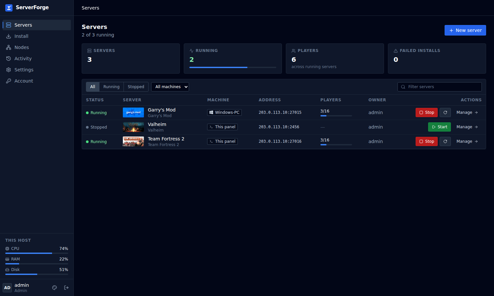
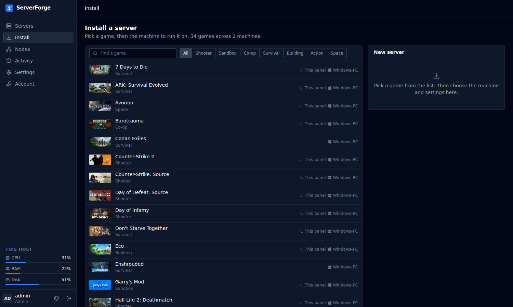
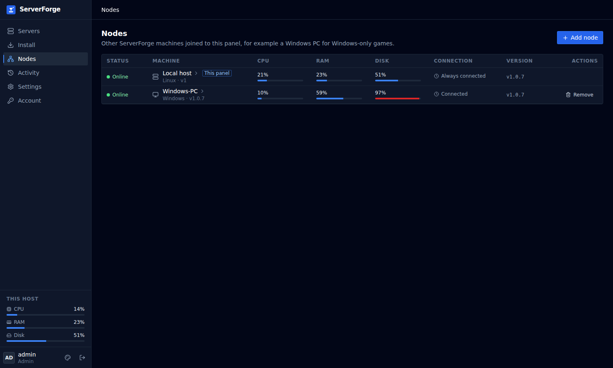
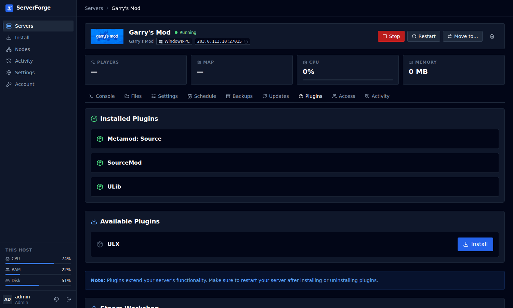
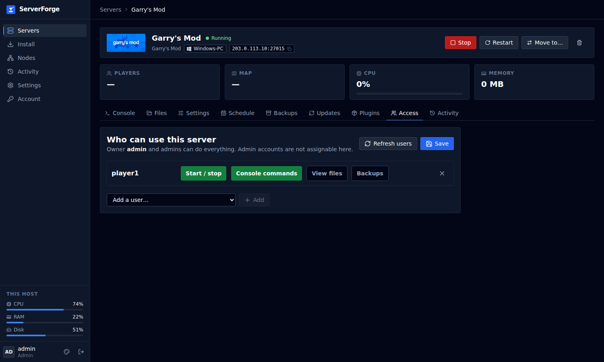
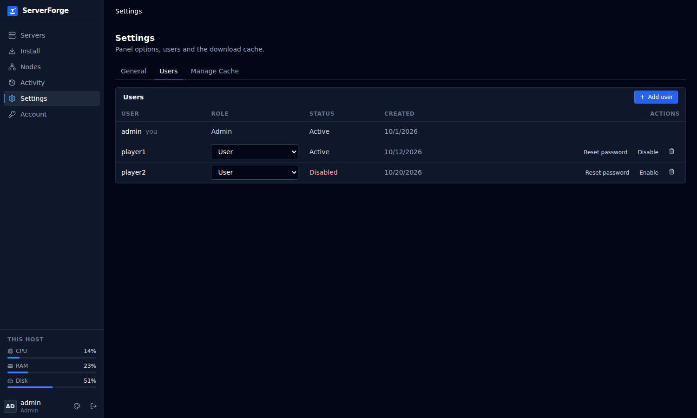
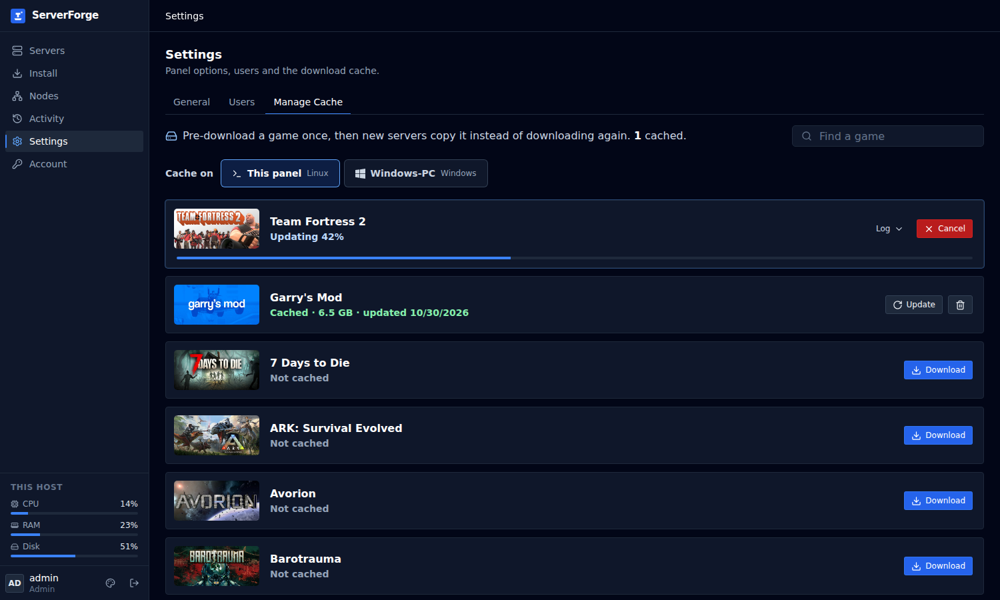
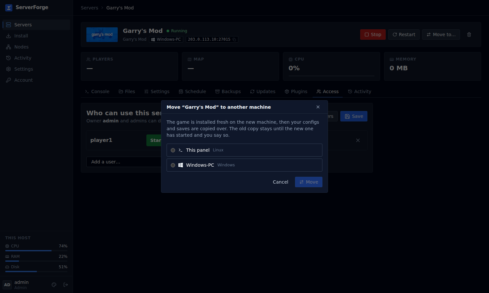
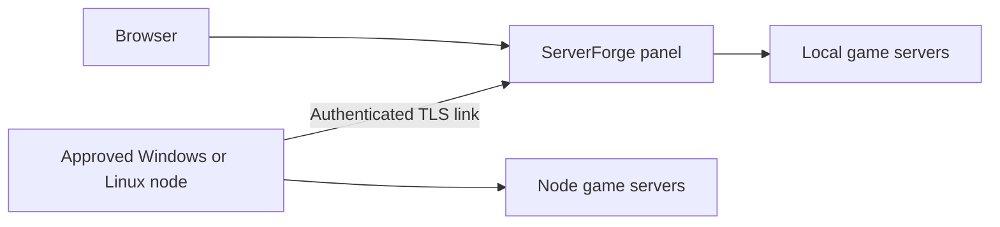

# ServerForge

A self-hosted panel for game servers on Linux and Windows, with local accounts, per-server access, live console output and connected machines.



## Features

- Pick a game, then choose the machine that will run it. The catalogue lists 34 games; availability depends on the machine's OS.
- Start, stop and restart servers; view console output and send commands.
- Edit files, manage backups, schedule tasks and inspect activity.
- Connect approved nodes over an authenticated TLS link; view machine folders, capacity and server locations.
- Move supported server configurations and saves between machines. The destination installs its own game binaries, using its ready cache when available. Moves preserve supported schedules, access grants and Workshop collection settings, with warnings if a step fails.
- Manage users, reset passwords, disable accounts and change roles. Account changes invalidate existing sessions.
- Install supported plugins and set Workshop collections locally or on compatible nodes. There is no plugin uninstall action yet.
- Download, update, cancel and resume each machine's game cache. Caches are OS-specific; Windows cache files cannot supply Linux installations. Node-to-node cache copying is not implemented.

## Screenshots

These screenshots use sample users, machine names and documentation IP addresses.

| Install a server | Connected machines |
|---|---|
|  |  |

| Plugins | Server access |
|---|---|
|  |  |

| Users | Cache updates |
|---|---|
|  |  |



## Run from source

Use Node.js 22 and npm. Linux and Windows are the tested host platforms; individual games have their own requirements. Steam games need SteamCMD and sufficient disk space. On Debian/Ubuntu, SteamCMD also needs the appropriate 32-bit runtime libraries, commonly `lib32gcc-s1`.

```sh
npm ci --prefix backend
npm ci --prefix frontend
npm run build --prefix frontend
```

Start the panel bound to loopback. In a POSIX shell:

```sh
HOST=127.0.0.1 PORT=3000 npm start
```

Or in PowerShell:

```powershell
$env:HOST = '127.0.0.1'
$env:PORT = '3000'
npm start
```

Open `http://localhost:3000`. The initial username is `admin`. Before the first start, set `ADMIN_PASSWORD` to your chosen password (at least eight characters), or retrieve the generated password from `backend/data/initial-admin-password`. Change it under Account after signing in. There is no shared default password.

For access from another device, configure a deliberate bind address, firewall rules and HTTPS. Keep data, backups, keys and credentials outside version control. Run a long-lived installation under a service manager; deployment examples are in `deploy/`. The bundled legacy installer scripts are not required for the source setup above.

## Connected Windows nodes

Use Nodes → Add node and follow [the multi-node guide](docs/MULTI-NODE.md). The Windows node package has its own version, separate from panel release tags. Update a node through Nodes → Update when the panel offers it. Stop games first when testing a node update; verify your own Windows installation before relying on unattended operation.



## Documentation

- [User guide](docs/USER-GUIDE.md)
- [Architecture](docs/ARCHITECTURE.md)
- [Multi-node setup and operation](docs/MULTI-NODE.md)
- [Backend protocol](docs/MULTI-NODE-BACKEND.md)
- [Docker deployment](DOCKER.md)
- [Release notes](docs/RELEASE-1.11.md)

## Development checks

```sh
npm test --prefix backend
npm run build --prefix frontend
```

The backend suite uses isolated fixtures. Real Steam downloads, Windows service updates and plugin installation on your own node require additional machine-specific checks.

## License

ISC. See the package metadata and included license files.
