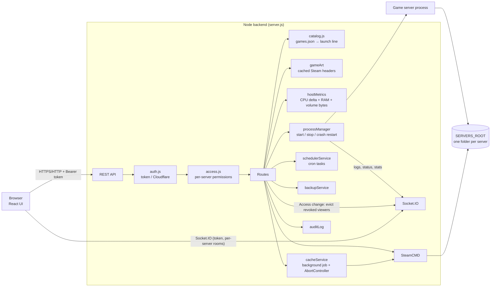

# How ServerForge fits together

**Install:** pick a game → `catalog.cleanVars` checks the settings → SteamCMD downloads into `SERVERS_ROOT/<name>` → `catalog.buildLaunch` turns the settings into an executable, an argument list and env → the server record is saved.

**Start:** the program must be inside the server folder. It runs with no shell, in its own process group, so Stop ends the whole game.

**Safety rules:**
- Only admins can install, change launch lines or settings, write files, or manage tasks and access.
- Users only see the servers they were given, with the permissions chosen in the Access tab.
- Saving server access also removes revoked viewers from existing Socket.IO rooms. The `watch` handler checks access again before joining.
- Successful local user saves emit an identity snapshot. Deleted accounts or changed roles/names disconnect their existing sockets, clearing all rooms and requiring a fresh authenticated connection. Cloudflare identities are separate from local accounts. There is currently no role-edit API; the same invalidation applies when a future role editor saves through the user store.
- Every change is written to the activity log.

**State:** `DATA_DIR` holds `users.json`, `servers.json`, `tasks.json`, `activity.jsonl`, `jwt-secret` and `initial-admin-password`. All are owner-only files.

**Cache jobs:** `POST /api/cache/download/:appId` saves/reserves the job and returns 202 while SteamCMD runs in the background. Duplicate starts and deletion during a job return 409. `POST /api/cache/:appId/cancel` aborts the tracked installer process group and waits for child closure before returning `cancelled`; the entry remains `downloading` during cancellation and the reservation remains held. Interrupted downloads become `interrupted` at startup; retry resumes the existing folder. Progress is clamped to 0–100 and persisted at most once per second, with a final terminal save; logs keep the latest 100 lines/about 16KB. Admins can read logs via cache list/status; ordinary users receive metadata only. SteamCMD signal exits are failures unless a genuine success message was observed, and explicit abort always wins. Windows tree termination is implemented but requires validation on Windows.

**Dashboard data:** authenticated `/api/host` is available to admins and users with server view access. It returns CPU percent from a two-second sample and memory/disk used/total in bytes; unavailable values are null. `/api/servers` adds nullable `players`/`maxPlayers` from recent game queries, cleared on failure or process changes and expired after 30 seconds. Queries finishing for replaced processes are discarded.

**Game artwork:** catalogue `storeAppId` identifies the storefront game, separate from the dedicated-server `appId`. Authenticated `/api/art/:gameId` serves cached JPEG headers from `DATA_DIR/game-art`. Only numeric catalogue IDs reach the fixed Steam CDN URL; downloads have size/time limits and no redirects. Missing art returns 404 for a UI fallback. Local-login clients fetch images with their bearer token before creating a browser object URL.

**Password changes:** local accounts persist a `sessionVersion`, included in login tokens and socket identities. A successful password change increments it, so prior HTTP tokens and socket handshakes are refused and existing sockets disconnect. The changing browser must sign in again. Legacy accounts/tokens without a version use 0 until their first password change. Cloudflare authentication is unchanged; any future password-reset path must also increment the version.
