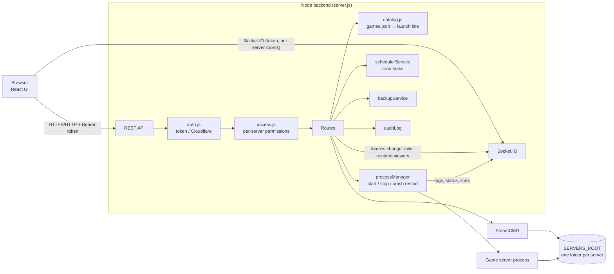

# How ServerForge fits together

**Install:** pick a game → `catalog.cleanVars` checks the settings → SteamCMD downloads into `SERVERS_ROOT/<name>` → `catalog.buildLaunch` turns the settings into an executable, an argument list and env → the server record is saved.

**Start:** the program must be inside the server folder. It runs with no shell, in its own process group, so Stop ends the whole game.

**Safety rules:**
- Only admins can install, change launch lines or settings, write files, or manage tasks and access.
- Users only see the servers they were given, with the permissions chosen in the Access tab.
- Saving server access also removes revoked viewers from existing Socket.IO rooms. The `watch` handler checks access again before joining.
- Successful local user saves emit an identity snapshot. Deleted accounts or changed roles/names disconnect their existing sockets, clearing all rooms and requiring a fresh authenticated connection. Cloudflare identities are separate from local accounts. There is currently no role-edit API; the same invalidation applies when a future role editor saves through the user store.
- Every change is written to the activity log.

**State:** `DATA_DIR` holds `users.json`, `servers.json`, `tasks.json`, `activity.jsonl`, `jwt-secret` and `initial-admin-password`. All are owner-only files.

**Password changes:** local accounts persist a `sessionVersion`, included in login tokens and socket identities. A successful password change increments it, so prior HTTP tokens and socket handshakes are refused and existing sockets disconnect. The changing browser must sign in again. Legacy accounts/tokens without a version use 0 until their first password change. Cloudflare authentication is unchanged; any future password-reset path must also increment the version.
