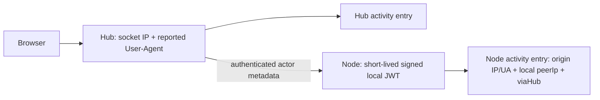

# Activity source attribution

Each new activity row has `ip`, `userAgent`, `peerIp` (strings or null) and `viaHub` (boolean), alongside its existing timestamp, user, action, server and detail. Reading older rows supplies null/null/null/false without rewriting the historic log. System/scheduler actions have no browser origin.

For a local browser request, `ip` and `peerIp` are the actual HTTP socket peer. IPv4-mapped IPv6 is normalized. Forwarded, X-Forwarded-For and CF-Connecting-IP headers are ignored: a caller must not choose their audit address. Behind a proxy this deliberately identifies the proxy peer until an explicit trusted-proxy policy is implemented.

For a remote action, the hub derives origin metadata, the authenticated node link carries it, and the local runtime signs only selected actor fields into a short-lived local administrator token. The node's auth middleware verifies that token/current account before attaching `hubActor`. `ip`/`userAgent` then describe the supplied hub origin, `peerIp` is the node panel's immediate HTTP peer, and `viaHub` is true. Unknown origins stay null rather than being replaced by loopback or the runtime HTTP client's user agent.

User-agent text is caller-reported, control-stripped and limited to 512 characters. It helps distinguish test sessions; it is not proof of a device or person. Render it as plain escaped text. No cookies, bearer tokens, passwords, request bodies or unrelated headers are captured. Audit metadata is excluded from mutation-idempotency hashes; the same operation does not execute again merely because its browser/IP metadata changes.

Tests cover header spoofing, normalization, bounds, old/system records, live local API attribution, signed remote attribution through two temporary panels, and mutation deduplication after metadata changes. The Activity UI and deployment/checklist remain owned by claude.
