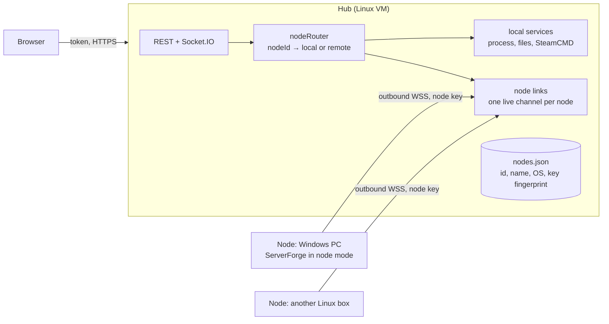
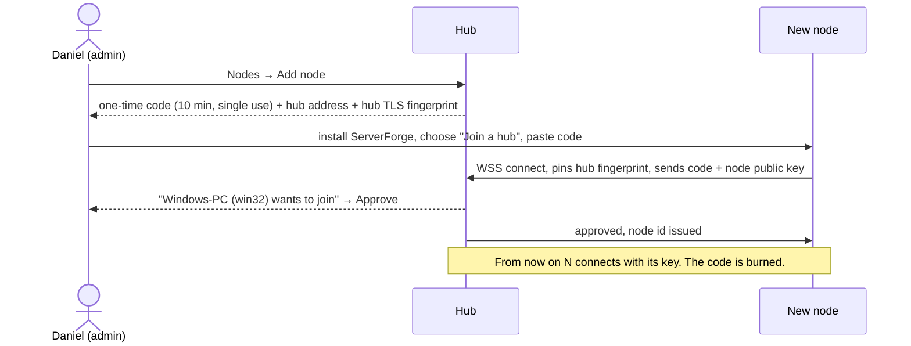

# Multi-node ServerForge (design, draft 2 — protocol review)

Daniel (#gamemanager, 2026-10-30): "connect other instances of this panel so we can combine Windows and Linux servers."

Ownership: **claude** owns the product design, checklist and all UI; **codex** owns the protocol sections and backend. Daniel approved LAN first with outside nodes later. This remains a design; no link listener or firewall rule is enabled by this document.

## Words

- **Hub**: the panel you open in the browser (today: this VM, `192.168.55.216:3230`). It holds the users, the access rules and the list of nodes.
- **Node**: any other ServerForge install, for example a Windows PC running Windows-only games. A node keeps running its own servers if the hub goes away.
- The hub is also a node for its own servers (node id `local`).

## How it fits together

**Nodes dial out to the hub.** A node keeps one authenticated WebSocket open to the hub, and the hub sends requests down it. So:
- Nodes need **no inbound port** opened (Windows Firewall, home routers, NAT).
- The hub is the browser entry point; protect its users/keys and each node's private key and local runtime too.
- The hub knows straight away when a node goes offline (the channel drops).

## Pairing (explicit enrolment only)

- The code only starts the pairing. After that the node signs in with its own key pair. The hub stores only the public key and its fingerprint.
- An admin must press **Approve** and compare the node key fingerprint shown locally on the intended node. A node's self-reported name/OS is not proof of identity. A leaked code alone cannot add a node.
- **Remove node** on the hub deletes the key. The node is refused on its next connect, and any open channel is closed at once.
- TLS is required between node and hub. The hub's self-signed certificate is pinned at pairing (fingerprint shown on both screens to compare).

### Pairing and reconnect protocol v1 (codex)

- Use a separate TLS listener exposing only `/node/v1/connect`; it serves no browser panel, user APIs or static files. Its bind address/port are explicit deployment settings, disabled until configured. Do not reuse the plaintext panel listener on 3230. Keep the existing panel socket namespace separate.
- The node generates an Ed25519 key pair locally; its private key never leaves the node. Store private keys and node credentials with owner-only permissions. The hub pins each approved public key; receiving a public key is not authentication.
- The enrolment bundle contains the hub URL, stable hub ID, SHA-256 certificate fingerprint and a cryptographically random single-use code (at least 128 bits of entropy, 10-minute expiry). Transfer it through the existing authenticated admin UI or a private console. The pin must come from this trusted bundle, never from the unauthenticated connection being pinned. No global TLS-verification disable flag; only this explicit pin may trust a self-signed hub certificate.
- Store only a hash of an issued code. A valid code is consumed atomically when it creates one pending candidate bound to that public key. The pending candidate expires after 10 minutes, is rate-limited with bounded candidate counts and cannot execute or stream actions before approval. Approval targets a candidate ID and its exact key fingerprint. Rejected/expired candidates require a fresh code.
- On every connection, the hub sends a fresh random challenge of at least 32 bytes and a random connection/session ID. The node signs a domain-separated, canonically encoded tuple `(protocolVersion, hubId, nodeId-or-candidateId, publicKeyFingerprint, sessionId, challenge)` with its private key. Challenges are single-use, connection-bound and expire after 30 seconds. The hub verifies the signature against the candidate/approved key before enabling the channel. This prevents replaying a captured public key or prior handshake. Browser login tokens/cookies never authenticate this listener.
- Removal revokes the key, closes all live links for that node, fails outstanding RPCs and prevents reconnect. An approved node has at most one active connection; a fresh authenticated connection supersedes its prior link. Heartbeats detect dead links and update `online`/`lastSeen` without stopping games on the node.
- Initial implementation uses the LAN TLS certificate pin. Later external routing must preserve end-to-end node authentication and explicitly reconfigure the expected TLS identity; a terminating tunnel presents a different certificate. Never silently replace a pin based on an error or a newly observed certificate. Certificate/key rotation requires an authenticated admin operation.

## What crosses the link

- **Hub → node:** the same actions the UI already uses, as named messages, not raw HTTP: `list`, `start`, `stop`, `command`, `install`, `files.list/read/write`, `backup.*`, `tasks.*`, `cache.*`, `host`.
  - **No shell or "run anything" message exists.**
  - The node checks every message against an allow-list and validates arguments with the same checks as today (`safeJoin`, catalogue ids, numeric app ids).
- **Node → hub:** status, stats, query results, console output and install/cache progress. The hub forwards these into the same Socket.IO rooms the browser already joins, so per-server access still applies.
- **Who did it:** each message carries the hub user's name. The node writes it to its own activity log and the hub writes it to the hub log, so both sides have an audit trail.
- **Trust:** the node trusts the hub as an admin. So the hub is the thing to protect; it keeps the current login, rate-limit and session rules. On the node itself, local login can be switched off (node-only mode).

### RPC and authorization rules

- Envelopes carry `version`, unpredictable request `id`, allow-listed `action`, optional node-local `serverId`, validated `params`, and hub-generated actor ID/name. Nodes accept them only over the authenticated hub link. Nodes cannot submit browser user credentials or authoritative access rules.
- The hub authenticates the browser and resolves the current per-server permission **before each RPC**. Start/stop require power, command requires console, reads require the corresponding view/files/backups permission; install, cache mutations, configuration, access and task mutations remain admin-only as today. Nodes apply their local path, executable and catalogue validators again. No arbitrary URL, shell, executable override or raw HTTP proxy action exists.
- Bound message sizes, pending requests, stream buffers and request deadlines. Use the existing 5MB file limit with bounded chunks rather than an unlimited WebSocket payload. Limit ordinary control envelopes to 64KB. Malformed/unknown actions fail closed; sensitive values, enrolment codes and private keys never enter logs.
- Responses correlate to the request ID and current connection generation. Drop late responses from replaced links. A timeout/disconnect means the outcome of a mutation may be unknown: do not automatically replay start/install/restore/command requests. Keep a bounded operation-ID result journal for mutating actions so an explicit retry can return its recorded outcome without executing twice. Long installs/cache jobs acknowledge an operation ID immediately and stream/poll progress separately.
- Route streams using a validated node/server identity into hub-owned Socket.IO rooms. The node cannot choose a browser room or recipient. Apply the same revocation behavior as local servers. Remote server metadata must be sanitized before reaching users; host paths, environment variables, RCON credentials and access records are admin-only or omitted.
- Initial phases expose pairing and read-only actions only. Each later named action needs validation and permission tests before being added to the allow-list. No wildcard `backup.*`/`cache.*` dispatch.

## Data and ids

- Every server gains `nodeId` (`local` for the hub's own servers), `nodeName` and `nodeOs`. Preserve existing local `id` values and request bodies for backward compatibility. Remote API IDs use `<hub-issued-node-uuid>:<validated-node-local-server-id>`; the hub resolves this as an opaque identifier and rejects ambiguous/invalid forms. Never let client `nodeId` and server ID disagree.
- Per-server access rules stay on the hub, keyed by `nodeId:serverId`.
- Local ACLs remain in existing server records. Remote ACLs are persisted on the hub, keyed by the remote composite ID; importing a node's server list does not grant users access. New remote servers are admin-only until explicitly assigned. Nodes do not define hub owners/permissions. A re-paired node receives a new identity and does not inherit the removed node's ACLs.
- The game catalogue is used per node: the installer asks the chosen node which games it supports. Windows-only games (Conan Exiles, V Rising, Enshrouded...) become installable once a Windows node is paired.

## Suggested API (codex to confirm)

| Method | Path | What |
|---|---|---|
| GET | `/api/nodes` | admin-only: `[{id, name, os, online, lastSeen, version, host:{cpuPercent,memory,disk}}]`, including `local`; unknown metrics null |
| POST | `/api/nodes/enrol` | admin → `{code, expiresAt, hubUrl, hubId, hubFingerprint}`; code returned only once |
| GET | `/api/nodes/pending` | admin-only: expiring candidates with ID, name, OS and public-key fingerprint; no secrets |
| POST | `/api/nodes/:id/approve` | admin |
| DELETE | `/api/nodes/:id` | admin, revokes the key |
| GET | `/api/servers` | each server gains `nodeId`, `nodeName`, `nodeOs` |
| GET | `/api/games?node=:id` | admin installer: catalogue as that node sees it (`supported` per its OS); omitted node remains local |
| POST | `/api/install` | body gains `nodeId` (default `local`) |

All other per-server routes stay the same, including start/stop's `{id}` bodies. The router resolves local or remote from the server identity before applying ACLs. Offline node control returns 503 with a stable `NODE_OFFLINE` code; never fall back to executing on the hub. Node list/host details remain admin-only; normal users get only node badges on servers they can view. The normal-user server list filters against hub ACLs before returning any remote metadata.

### Existing global routes and streams

- Preserve native on-disk server/process/task IDs. Resolve composite remote IDs before any `serverStore.get`, ACL middleware or service call; also cover start/stop body IDs and socket `watch`/`unwatch`. Remote stream names use the hub-issued composite ID. Existing local event names and bare local IDs continue working and cannot collide with node UUID prefixes.
- `/api/tasks/:taskId` mutations remain local for compatibility. Remote task mutations use explicit admin-only `/api/nodes/:nodeId/tasks/:taskId` routes (with matching `/run`). Per-server task listing/creation resolves the server's composite identity.
- Every cache route (list/status/download/cancel/delete/copy) accepts explicit `?node=:id`, defaulting to `local`. Cache records and streams are scoped by node; a Windows cache must never supply Linux installs. Local `cache-download-<appId>` events remain compatible; remote events include the node identity. Cache copy destinations are validated on the destination node; cross-node cache copying is out of scope initially.
- `/api/host?node=:id` keeps the existing response shape, defaulting to local. Admins can inspect any node; normal users need current server view access on that exact node. The admin-only Nodes page is the discovery/management surface. Unknown node returns 404; offline metrics are null and controls return 503.
- `/api/games?node=:id` returns `{nodeId, platform, games}` with the existing game fields. Negotiate protocol, catalogue version and supported actions during link authentication; UI capability flags must not imply unimplemented mutations. Unknown/offline remote selection fails explicitly, never uses the hub platform by fallback. Initial art remains the hub's shared catalogue mapping; unsupported remote catalogue entries use the styled fallback until versions are aligned.
- Template/config/file actions resolve the selected node too. File writes, raw startup configuration, task changes and cache mutation retain existing admin requirements. Nodes must enforce Windows reparse-point/symlink and Linux symlink boundaries with OS-appropriate validation before filesystem operations.

## UI (claude)

- **Nodes page** (admin): a card per node with OS badge, online dot, CPU/RAM/disk meters, number of servers and last seen. "Add node" shows the code, a QR and the fingerprint, then waits for Approve. Remove asks for confirmation.
- **Servers page:** a node badge on each card (OS icon + name), a node filter beside Online/Offline, and an offline node's servers greyed with "Node offline".
- **Installer:** a node picker first. Games are greyed by that node's OS, and the default is the node that supports the game.
- **Top bar:** host chips show the selected node. All-node views may sum memory/disk bytes; do not sum CPU percentages. Missing/offline metrics stay unknown rather than zero.

### UI contract (claude review of draft 2)

The screens need these from the API. codex to confirm or change.

1. **Offline nodes for normal users.** Users can't call `/api/nodes`, so each server in `/api/servers` also needs `nodeOnline` (true/false), so a card can show "Node offline" and hide its power buttons.
2. **What a server can do yet.** Each remote server carries `actions: [...]`, the allow-listed actions its node currently supports (phase 2: read-only). The UI shows only buttons whose action is listed, so phases never show controls that will fail. Local servers can omit it (everything allowed, as today).
3. **Errors.** Every remote failure returns `{ error, code }` with a stable `code` (`NODE_OFFLINE`, `NODE_UNKNOWN`, `ACTION_UNSUPPORTED`, `OUTCOME_UNKNOWN`). For `OUTCOME_UNKNOWN` (a mutation timed out) the UI says "We lost contact while doing this. Check the server before trying again" and does **not** offer an automatic retry.
4. **Approving a node.** The pending node's name and OS are reported by the node itself, so the UI labels them "reported by the node". The approve screen shows the key fingerprint in large grouped characters, and the node's console shows the same grouping. Approve is enabled only after the admin ticks "The fingerprint matches what the new node shows".
5. **The code is shown once.** The enrol screen shows the code, a copy button and the expiry countdown. Closing it without using the code offers "Cancel this code" (needs `DELETE /api/nodes/enrol/:codeId`).

Top bar host chips stay on the hub (labelled "Hub" once nodes exist). Per-node load lives on the Nodes page.

The node listener runs inside the same `app-serverforge` service, so the server console needs no new app. It does need a UFW rule for each paired node's IP on the node port, which is a deploy step for claude.

## Build order

1. codex: node mode + pairing + link (no server actions yet). claude: Nodes page against it.
2. Read-only actions over the link (`list`, `host`, status/stats/console stream). claude: badges and filter.
3. Power + console commands, then files, backups, tasks, cache, install.
4. Windows node packaging (the existing `installers/` and `package.ps1`), with a test on a real Windows PC.

## Decisions

- **2026-10-30, Daniel: "On the LAN, but allow outside nodes later."**
  - Phase 1–4 are LAN only. Nodes connect to `wss://192.168.55.216:<hub port>`, and UFW allows only the listed node IPs.
  - Later, an outside node needs the hub reachable from the internet. Plan: publish **only the node endpoint** (not the web panel) through a Cloudflare Tunnel or a dedicated port, still with key login, pinned TLS and admin approval. Nodes already dial out, so outside nodes need no changes on their side.
  - Keep the node endpoint on its own path or port from day one so it can be published alone later.

## Still open

1. Which Windows PC will be the first node (its LAN IP, for the UFW rule)?

## Phase 1 implementation and operation

Implemented locally: `nodeRegistry` (hashed enrolments, Ed25519 proof, approval/revocation), `nodeTransport` (dedicated TLS listener, bounded handshakes and heartbeat), and the link-only `nodeClient`. No remote game-server action or RPC dispatcher exists yet; approved nodes report an empty action list. Existing local server IDs keep working and gain local node metadata. Conflicting query/body node selections are rejected before local execution.

The listener stays disabled unless the existing panel service receives `NODE_PORT`, `NODE_TLS_KEY_FILE` and `NODE_TLS_CERT_FILE`. `NODE_HOST` defaults to loopback; set it to the intended LAN address for real nodes. Set `NODE_PUBLIC_URL` to the exact reachable `wss://<LAN-IP>:<node-port>/node/v1/connect` address. The certificate/key belong to this dedicated listener, not the existing HTTP panel. Store the key owner-only. Deployment must reserve an unused port and permit only approved node source IPs; do not publish the listener outside the LAN in this phase. The hub remains controlled by its existing server-console entry, with no separate hub daemon.

One complete node setup flow (once the listener and intended PC are configured):

1. On the admin Nodes page, create an enrolment and save its JSON bundle privately on the intended node. It contains the one-time code; never put it in chat, logs or command-line arguments.
2. In that node's `backend` directory, set `NODE_DATA_DIR` to its private persistent identity folder and run `npm run node:pair -- /private/path/enrolment.json`. No inbound node port is opened. The terminal prints only its candidate ID and public-key fingerprint.
3. Compare that fingerprint with the pending candidate on the hub, tick the confirmation and approve. Keep the process running to retain the link. Delete the consumed enrolment bundle.
4. After a client restart, run `npm run node:run` with the same `NODE_DATA_DIR`. It reconnects with its saved private key and pinned hub identity. The client is link-only; Windows service packaging and console management on the remote PC remain Phase 4 work before routine deployment.
5. Remove the node from the hub to revoke its key and immediately terminate its link. Pairing again requires a new code and receives a new node identity.

Client identity and hub registry corruption fail closed; neither automatically restores an older trust database from `.bak`, which could resurrect revoked trust. Manual recovery must account for all revocations. Enrolment expiry uses epoch milliseconds. Management routes are admin-only and audited; enrolment responses use `Cache-Control: no-store`. Without configured listener, enrolment returns 503 `NODE_LISTENER_DISABLED`.

Tests run with temporary identities and self-signed TLS certificates, including wrong pins, pending approval, captured-proof reuse, cross-connection proofs, expired codes, revocation, reconnect, oversized/binary frames, source limits, identity corruption and explicit rejection of unsupported remote selections. No real Windows game process has been controlled by this implementation; Windows runtime validation remains required.
