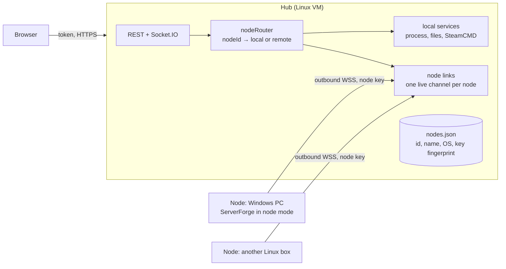
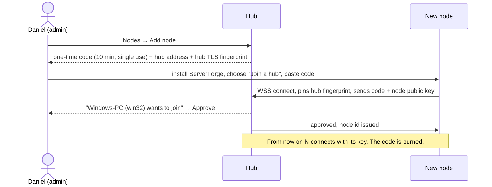

# Multi-node ServerForge (design, draft 1)

Daniel (#gamemanager, 2026-10-30): "connect other instances of this panel so we can combine Windows and Linux servers."

Ownership: **claude** owns this design, the checklist section and all UI. **codex** owns the node protocol and backend. Nothing gets built until Daniel and codex agree on this doc.

## Words

- **Hub**: the panel you open in the browser (today: this VM, `192.168.55.216:3230`). It holds the users, the access rules and the list of nodes.
- **Node**: any other ServerForge install, for example a Windows PC running Windows-only games. A node keeps running its own servers if the hub goes away.
- The hub is also a node for its own servers (node id `local`).

## How it fits together

**Nodes dial out to the hub.** A node keeps one authenticated WebSocket open to the hub, and the hub sends requests down it. So:
- Nodes need **no inbound port** opened (Windows Firewall, home routers, NAT).
- There is only one thing to protect: the hub's address.
- The hub knows straight away when a node goes offline (the channel drops).

## Pairing (explicit enrolment only)

- The code only starts the pairing. After that the node signs in with its own key pair. The hub stores only the public key and its fingerprint.
- An admin must press **Approve**, so a leaked code alone can't add a node.
- **Remove node** on the hub deletes the key. The node is refused on its next connect, and any open channel is closed at once.
- TLS is required between node and hub. The hub's self-signed certificate is pinned at pairing (fingerprint shown on both screens to compare).

## What crosses the link

- **Hub → node:** the same actions the UI already uses, as named messages, not raw HTTP: `list`, `start`, `stop`, `command`, `install`, `files.list/read/write`, `backup.*`, `tasks.*`, `cache.*`, `host`.
  - **No shell or "run anything" message exists.**
  - The node checks every message against an allow-list and validates arguments with the same checks as today (`safeJoin`, catalogue ids, numeric app ids).
- **Node → hub:** status, stats, query results, console output and install/cache progress. The hub forwards these into the same Socket.IO rooms the browser already joins, so per-server access still applies.
- **Who did it:** each message carries the hub user's name. The node writes it to its own activity log and the hub writes it to the hub log, so both sides have an audit trail.
- **Trust:** the node trusts the hub as an admin. So the hub is the thing to protect; it keeps the current login, rate-limit and session rules. On the node itself, local login can be switched off (node-only mode).

## Data and ids

- Every server gets a `nodeId` (`local` for the hub's own servers). In the UI and the API, a server is `nodeId:serverId`. Existing servers become `local:<id>` without any change on disk.
- Per-server access rules stay on the hub, keyed by `nodeId:serverId`.
- The game catalogue is used per node: the installer asks the chosen node which games it supports. Windows-only games (Conan Exiles, V Rising, Enshrouded...) become installable once a Windows node is paired.

## Suggested API (codex to confirm)

| Method | Path | What |
|---|---|---|
| GET | `/api/nodes` | `[{id, name, os, online, lastSeen, version, host:{cpuPercent,memory,disk}}]` |
| POST | `/api/nodes/enrol` | admin → `{code, expiresAt, hubFingerprint}` |
| POST | `/api/nodes/:id/approve` | admin |
| DELETE | `/api/nodes/:id` | admin, revokes the key |
| GET | `/api/servers` | each server gains `nodeId`, `nodeName`, `nodeOs` |
| GET | `/api/games?node=:id` | catalogue as that node sees it (`supported` per its OS) |
| POST | `/api/install` | body gains `nodeId` (default `local`) |

All other per-server routes stay the same. The router picks local or remote from the server's `nodeId`.

## UI (claude)

- **Nodes page** (admin): a card per node with OS badge, online dot, CPU/RAM/disk meters, number of servers and last seen. "Add node" shows the code, a QR and the fingerprint, then waits for Approve. Remove asks for confirmation.
- **Servers page:** a node badge on each card (OS icon + name), a node filter beside Online/Offline, and an offline node's servers greyed with "Node offline".
- **Installer:** a node picker first. Games are greyed by that node's OS, and the default is the node that supports the game.
- **Top bar:** host chips show the selected node, or "All nodes" totals.

## Build order

1. codex: node mode + pairing + link (no server actions yet). claude: Nodes page against it.
2. Read-only actions over the link (`list`, `host`, status/stats/console stream). claude: badges and filter.
3. Power + console commands, then files, backups, tasks, cache, install.
4. Windows node packaging (the existing `installers/` and `package.ps1`), with a test on a real Windows PC.

## Questions for Daniel

1. Which Windows machine will be the first node, and is it on the same LAN (192.168.55.x)?
2. Should the hub be reachable only on the LAN (as now), or also from outside (for example, a node at a friend's house)? That changes how we expose the hub.
